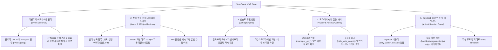

# MVP 정의 및 개발 세부 계획서 (plan_202610112227.md)

- **작성 일시**: 2026-10-11 22:27
- **대상 시스템**: VoteEvent (참여형 투표 이벤트 웹 플랫폼)
- **문서 목적**: 사용자의 전체 요구사항을 바탕으로 최소 기능 제품(MVP)을 명확히 정의하고, 이를 달성하기 위한 개발 세부 요구 계획 수립

---

## 1. 최소 기능 제품 (MVP, Minimum Viable Product) 정의

### 1.1 MVP 개요 및 핵심 가치
**VoteEvent** 플랫폼의 핵심 가치는 **"누구나 간편하게 주제별 투표 행사를 개설하고, 참여자들이 자유롭게 작품이나 항목을 등록하여 실시간으로 선호도(좋아요)를 투표할 수 있는 안전하고 신뢰할 수 있는 인터랙티브 웹 서비스"**를 제공하는 것입니다.

### 1.2 MVP 핵심 기능 스코프 (Core Feature Set)

#### ① 이벤트 라이프사이클 관리 (Event Lifecycle & Immutability)
- **이벤트 CRUD**: 관리자 전용 대시보드에서 이벤트 생성, 조회, 수정, 삭제 제공.
- **간편 Subpath 랜딩**: 누구나 `{DEFAULT_PREFIX}/{slug}` (예: `/votes/bazaarposter`)로 즉시 접근.
- **종료 이벤트 불변성(Immutability)**:
  - 이벤트가 마감(`is_active=False`)되면 프론트엔드에서 신규 항목 등록 버튼, 수정/삭제 버튼, 좋아요 투표 버튼이 `disabled` 처리되고 자물쇠 아이콘이 표시됨.
  - 백엔드 API에서도 종료된 이벤트에 대한 항목 생성, 수정, 삭제, 투표 요청 시 `400 Bad Request`로 엄격히 차단.

#### ② 참여 항목 등록 및 미디어 최적화 (Items & Media Pipeline)
- **사용자 참여 항목 등록**: 참여자는 폼/모달을 통해 제목, 설명, 대표 이미지(또는 비디오), 4자리 이상 PIN을 입력하여 등록.
- **1920px 자동 다운스케일링**: 업로드된 이미지 폭이 1920px를 초과할 경우 비율을 유지하며 정확히 1920px로 축소 및 WebP/JPEG 최적화 압축 저장.
- **PIN 보안 검증**: 단방향 해시(SHA-256)로 저장되어 작성자 본인만 PIN 일치 시 수정 및 삭제 가능.

#### ③ 선호도(좋아요) 투표 엔진 (Voting Engine)
- **원클릭 비동기 투표**: 카드뷰, 모아보기 그리드, 상세 모달 어디서든 비동기(Fetch)로 즉각 반영.
- **중복 투표 방지**: 브라우저 로컬 스토리지 기반으로 1차 중복 방지 및 UI 활성화 상태 유지.

#### ④ 접근 제어 및 표시 옵션 (Access Control & Options)
- **`manager_only` (관리자만 연결)**: 이벤트 옵션 활성화 시 관리자 권한이 없는 사용자는 안내 페이지(403)로 차단하고, 이벤트 목록 카드에 `관리자만 접근` 방패 뱃지 노출.
- **`hide_vote_counts` (좋아요 횟수 숨기기)**: 일반 사용자에게는 총 득표수 "비공개", 카드 뱃지 미노출, API 응답 `vote_count: 0` 마스킹, 인기순 정렬 숨김. 관리자는 실제 득표수 확인 가능.

#### ⑤ 중앙 Keycloak 인증 및 안정적인 세션 검증 (Auth & Session Guard)
- **비동기 `verify_admin_session`**: `AUTH_VERIFY_URL`을 통해 Keycloak API 프록시에서 관리자 세션을 안전하게 비동기 검증.
- **사전 검증 절차 (`handleManagerAction`)**: 관리자 기능 버튼 클릭 시 외부로 튕겨 나가지 않고 내부 엔드포인트(`/api/auth/status`)를 먼저 조회하여 세션 검증 후 분기.
- **로컬 개발 환경 Origin 보존**: 비인가 시 `window.location.origin`을 포함한 완전한 URL을 `redirect` 파라미터로 넘겨 로컬호스트 복귀 보장.
- **무한 루프 방지 가드 (Loop Breaker)**: `auth_attempted=1` 플래그를 통해 Keycloak 왕복 후에도 세션이 없는 경우 303 무한 루프를 차단하고 403으로 안전하게 중단.

---

## 2. 개발 세부 요구 계획 (Detailed Requirements & Plan)

### 2.1 세부 요구사항 목록 (Phased Tasks)

| 단계 | 세부 작업 항목 | 대상 모듈 / 파일 | 요구사항 명세 |
| :---: | :--- | :--- | :--- |
| **Phase 1** | **종료된 이벤트 상태 제어 및 불변성 보장** | `event_service.py`, `item_service.py`, `vote_service.py`, `detail.html` | - `is_active=False` 이벤트에 대해 신규 항목 등록, 기존 항목 수정/삭제, 투표 시 백엔드 400 에러 반환 - 프론트엔드 버튼 `disabled` 처리 및 마감 안내 배너 표시 |
| **Phase 2** | **Keycloak 비동기 검증 연동** | `core/auth.py`, `routers/admin_router.py`, `core/config.py` | - `verify_admin_session(auth_session)` 구현 및 `AUTH_URL` 환경변수 참조 - `GET /votes/api/auth/status` 엔드포인트 구현 |
| **Phase 3** | **관리자 전용 & 득표수 숨김 옵션 구현** | `models/event.py`, `event_view_router.py`, `item_router.py`, `detail.html`, `403.html` | - 이벤트 모델에 `manager_only`, `hide_vote_counts` 컬럼 추가 - 비관리자 접근 시 403 차단 안내 페이지 렌더링 - 일반 사용자 대상 득표수 0 마스킹 및 인기순 정렬 옵션 숨김 |
| **Phase 4** | **사전 검증 헬퍼(`handleManagerAction`) 구현** | `templates/base.html`, `templates/admin/event_list.html` | - 개설/수정/삭제 버튼 클릭 시 `/api/auth/status` 사전 검증 - 관리자 세션 유효 시 즉시 이동, 미인증 시 origin 결합 redirect URL로 Keycloak 호출 - 페이지 로드 시 백그라운드 UI 동기화 |
| **Phase 5** | **서버 사이드 비동기 통일 및 무한 루프 방지** | `core/auth.py`, `routers/admin_router.py`, `main.py` | - `require_manager_web` 비동기화 및 `verify_admin_session` 호출 일치 - `auth_attempted=1` 기반 Loop Breaker 적용 - `create`, `edit`, `delete` 핸들러 `async def` 통일 |
| **Phase 6** | **테스트 자동화 및 회귀 검증** | `tests/test_vote_event.py` | - 종료 이벤트 차단 테스트 - 관리자 전용/득표수 숨김 테스트 - 사전 검증 스크립트 및 상태 API 테스트 - 리다이렉트 무한 루프 방지 테스트 (총 33개 테스트) |

---

## 3. 검증 및 품질 보증 (QA) 계획

1. **자동화 단위/통합 테스트 (Pytest)**
   - `pytest`를 통해 전체 33개 테스트 케이스가 무결하게 통과하는지 검증.
   - 테스트 커버리지: 라우팅, 이미지 변환(1920px), 투표 카운트, PIN 해시, Keycloak 비동기 검증, 무한 루프 방지 가드.

2. **브라우저 교차 검증**
   - 로컬 환경(`localhost:8000`) 및 외부 도메인 배포 환경에서의 쿠키/세션 전달 동작 검증.
   - 관리자/일반인/익명 방문자 시나리오별 권한 제어 UI 정상 노출 검증.
