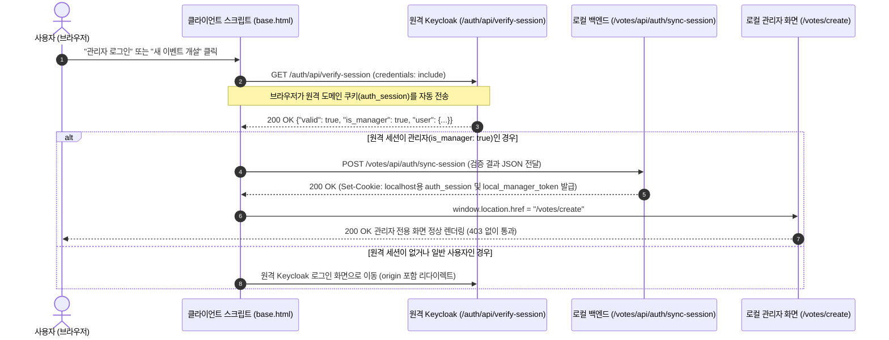

# MVP 정의 및 개발 세부 계획서 (plan_202610112256.md)

- **작성 일시**: 2026-10-11 22:56
- **대상 시스템**: VoteEvent (참여형 투표 이벤트 웹 플랫폼)
- **문서 목적**: 웹 스크립트 기반 원격 Keycloak 세션 검증(`verify-session`) 및 로컬 백엔드 세션 동기화(`sync-session`)를 통한 403 Forbidden 해결 계획 수립

---

## 1. 최소 기능 제품 (MVP) 정의 및 해결 아키텍처

### 1.1 MVP 개요
로컬 개발 환경(`localhost`)과 원격 인증 도메인(`holyseeds.thewayworks.net`) 간의 브라우저 쿠키 격리 문제를 완벽히 해결하여, **"웹 스크립트(클라이언트 브라우저)가 원격 Keycloak 세션을 직접 검증하고, 검증된 관리자 세션을 로컬 백엔드에 즉시 동기화하여 끊김 없는 로컬/프로덕션 관리자 권한을 보장하는 인증 브릿지 MVP"**를 구현합니다.

### 1.2 인증 브릿지 시퀀스 다이어그램

---

## 2. 개발 세부 요구 계획 (Detailed Implementation Plan)

### 단계 1: 템플릿 전역 변수 확장 (`app/core/templates.py`)
- `templates.env.globals["auth_verify_url"] = AUTH_VERIFY_URL`
- `templates.env.globals["AUTH_VERIFY_URL"] = AUTH_VERIFY_URL` 등록하여 모든 Jinja2 템플릿 및 클라이언트 스크립트에서 동적 참조 가능하도록 지원.

### 단계 2: 로컬 백엔드 세션 동기화 엔드포인트 구현 (`app/routers/admin_router.py`, `app/core/auth.py`)
- `POST /votes/api/auth/sync-session`:
  - 클라이언트 스크립트가 보낸 JSON 페이로드(`valid`, `is_manager`, `user`, `role_flag` 등) 수신.
  - 관리자 조건(`is_manager is True` 또는 `role_flag in ("1", "2")` 또는 `manager in roles`) 검증.
  - 서명된 로컬 토큰(`local_manager_token`) 발급 및 `auth_session` 쿠키 생성.
  - `response.set_cookie(...)`로 `localhost` 도메인에 쿠키 주입 (`path="/"`, `samesite="lax"`).
- `app/core/auth.py`의 `extract_auth_session` 및 `verify_admin_session`, `verify_auth_session`:
  - 로컬에 발급된 `local_manager_token` 및 동기화된 세션도 정당한 관리자 세션으로 인식.

### 단계 3: 프론트엔드 웹 스크립트 고도화 (`app/templates/base.html`)
- `verifyRemoteSessionWeb()` 함수 구현:
  - 브라우저에서 직접 `AUTH_VERIFY_URL`(`https://holyseeds.thewayworks.net/auth/api/verify-session`)을 `credentials: 'include'`로 비동기 호출.
  - 성공적으로 `is_manager: true`를 얻으면 로컬 백엔드 `/api/auth/sync-session`으로 전송하여 로컬 쿠키 장착.
- `handleManagerAction(event, targetPath, onSuccessCallback)` 함수 개선:
  - 1차: 브라우저에서 `verifyRemoteSessionWeb()`를 통해 원격 세션을 직접 확인 및 로컬 쿠키 동기화.
  - 2차: 관리자 확인 완료 시 즉시 `targetPath`로 이동하거나 콜백 실행.
  - 3차: 미인증 시 원격 Keycloak 로그인 URL(`origin` 결합)로 리다이렉트.
- `DOMContentLoaded` 백그라운드 자동 동기화:
  - 페이지 로드 시 백그라운드에서 원격 세션을 확인하여 로컬 백엔드와 자동 동기화 및 네비게이션 관리자 UI(로그인/로그아웃/자물쇠 아이콘) 즉각 반영.

### 단계 4: 403 Forbidden 에러 자동 복구(Self-Healing) 브릿지 구현 (`app/templates/event/403.html`)
- 사용자가 직접 URL 입력 등으로 로컬 쿠키 없이 `/votes/create` 등에 진입하여 403에 도달했을 경우,
- 403 화면의 스크립트가 즉시 브라우저에서 `verifyRemoteSessionWeb()`를 백그라운드 호출.
- 관리자 권한이 확인되면 즉시 로컬 세션을 동기화하고 원래 가려던 페이지로 `window.location.reload()` 자동 복구.

### 단계 5: 자동화 테스트 작성 및 전체 검증 (`tests/test_vote_event.py`)
- `POST /votes/api/auth/sync-session` 엔드포인트 동작 검증 테스트
- 웹 스크립트 동기화 후 `/votes/create` 정상 접근(403 회피) 검증 테스트
- 전체 33개 이상 테스트 전원 통과 확인
