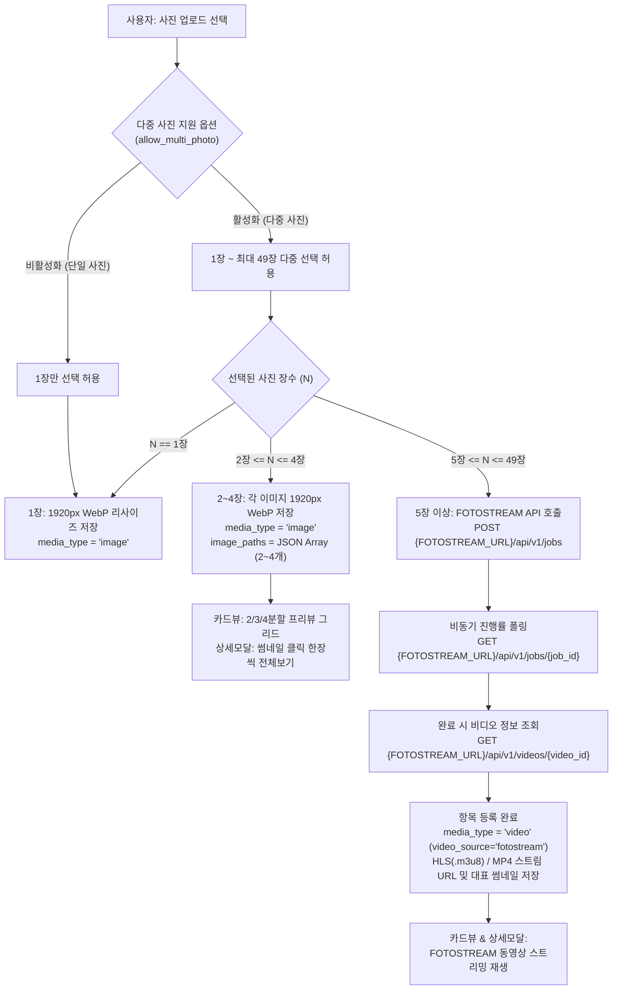

# 다중 사진(2~4장 그리드 프리뷰/개별 상세보기), 5장 이상 FOTOSTREAM 영상 변환 및 `.env` 환경변수 일원화 개발 계획서 (plan_202610161022.md)

- **작성 일시**: 2026-10-16 10:22
- **대상 시스템**: VoteEvent (참여형 투표 이벤트 웹 플랫폼)
- **연동 명세**: [`C:\Dev\python\fotostream\fotostream_api.md`](file:///C:/Dev/python/fotostream/fotostream_api.md), [`.env`](file:///C:/Dev/python/voteEvent/.env)

---

## 1. 개요 및 목표 (Executive Summary)

본 계획서는 다음 두 가지 핵심 축을 중심으로 시스템 아키텍처와 프론트엔드/백엔드 수정 사항을 수립합니다.

1. **`.env` 기반 환경변수 일원화 및 하드코딩 엔드포인트 제거**:
   - [`.env`](file:///C:/Dev/python/voteEvent/.env)에 정의된 `DEFAULT_PREFIX`, `AUTH_URL`, `AUTH_VERIFY_URL`, `VDSTREAM_URL`, `FOTOSTREAM_URL`을 애플리케이션 시작 시 정확히 로드하고(`${AUTH_URL}` 변수 확장 포함), 파이썬 코드 및 Jinja2 HTML/JS 템플릿 내부에 하드코딩된 URL 폴백 문자열을 전면 제거합니다.
2. **다중 사진 등록 옵션 및 사진 장수별 스마트 미디어 파이프라인**:
   - **이벤트 설정 (`allow_multi_photo`)**: 이벤트 개설/수정 시 다중 사진 등록 허용 옵션을 제공하며, 항목 등록 시에도 단일/다중 사진 모드를 직관적으로 지원합니다.
   - **1장 등록**: 기존 단일 이미지(1920px WebP 리사이즈) 업로드 및 단일 뷰어 제공.
   - **2장 ~ 4장 등록**: 다중 이미지를 각각 1920px WebP로 최적화 저장하고, **카드 목록에서는 프리뷰 영역을 2/3/4분할 그리드로 구성해 한 번에 모든 사진을 노출**하며, **상세보기 모달에서는 썸네일 리스트 및 좌우 전환을 통해 한 장씩 선택하여 고화질 전체보기**를 지원합니다.
   - **5장 이상 등록 (최대 49장)**: [`fotostream_api.md`](file:///C:/Dev/python/fotostream/fotostream_api.md) 규격에 따라 **FOTOSTREAM 엔진(`POST /api/v1/jobs` -> 상태 폴링 -> `GET /api/v1/videos/{video_id}`)을 호출하여 업로드된 사진들을 동영상 스트림(HLS `.m3u8` 및 MP4)으로 자동 합성**하고, 카드 프리뷰 및 상세보기 모달에서 동영상 스트림으로 재생합니다.

---

## 2. `.env` 환경변수 및 하드코딩 URL 전수 조사 & 수정 계획

### 2.1 `.env` 파일 설정 현황
현재 [`.env`](file:///C:/Dev/python/voteEvent/.env) 파일의 정의는 다음과 같습니다:
```env
DEFAULT_PREFIX=/votes

# 3. Keycloak 중앙 인증 프록시 URL 환경변수 (auth_spec.md 준수)
AUTH_URL=https://holyseeds.thewayworks.net/auth
AUTH_VERIFY_URL=${AUTH_URL}/api/verify-session

VDSTREAM_URL=https://holyseeds.thewayworks.net/vdstream
FOTOSTREAM_URL=https://holyseeds.thewayworks.net/fotostream
```

### 2.2 코드 내 하드코딩 및 환경변수 불일치 지점 전수 조사 결과

| 구분 | 대상 파일 | 현재 상태 (문제점) | 수정 계획 |
| :--- | :--- | :--- | :--- |
| **Config 로더** | [`app/core/config.py`](file:///C:/Dev/python/voteEvent/app/core/config.py) | 1. `.env` 파일을 읽는 코드가 없어 OS 환경변수로 직접 주입되지 않으면 기본값만 사용됨.<br>2. `.env`의 `AUTH_VERIFY_URL=${AUTH_URL}/api/verify-session`에서 `${AUTH_URL}` 치환 처리 필요.<br>3. `.env`는 `VDSTREAM_URL`을 사용하나 코드는 `VDSTREAM_BASE_URL`만 조회함.<br>4. `FOTOSTREAM_URL` 환경변수 미정의. | 1. `config.py` 상단에서 `.env` 파일을 로드하고 `${VAR}` 치환(Interpolation)을 지원하는 로더 구현.<br>2. `VDSTREAM_URL = os.getenv("VDSTREAM_URL", os.getenv("VDSTREAM_BASE_URL", ...))` 및 하위 호환 별칭 `VDSTREAM_BASE_URL = VDSTREAM_URL` 제공.<br>3. `FOTOSTREAM_URL` (및 `FOTOSTREAM_BASE_URL`) 추가. |
| **템플릿 전역변수** | [`app/core/templates.py`](file:///C:/Dev/python/voteEvent/app/core/templates.py) | `default_prefix`, `auth_url`, `auth_verify_url`만 등록되어 있고 `vdstream_url`, `fotostream_url` 미등록. | `vdstream_url` (`VDSTREAM_URL`), `fotostream_url` (`FOTOSTREAM_URL`) 전역 변수 추가 등록. |
| **공통 레이아웃** | [`app/templates/base.html`](file:///C:/Dev/python/voteEvent/app/templates/base.html) | - L67: ``<br>- L158: `'{{ auth_verify_url if auth_verify_url else "https://holyseeds.thewayworks.net/auth/api/verify-session" }}'`<br>- L237: `'{{ auth_url if auth_url else "https://holyseeds.thewayworks.net/auth" }}'` | 하드코딩된 `'https://holyseeds.thewayworks.net/...'` 폴백 문자열을 제거하고, `templates.py` 전역 변수(`{{ auth_url }}`, `{{ auth_verify_url }}`)를 직접 참조하도록 수정. |
| **관리자 목록** | [`app/templates/admin/event_list.html`](file:///C:/Dev/python/voteEvent/app/templates/admin/event_list.html) | - L7: `` | 하드코딩 폴백을 제거하고 `{{ auth_url }}` 전역 변수를 사용하도록 수정. |
| **VDSTREAM 연동** | [`app/services/vdstream_service.py`](file:///C:/Dev/python/voteEvent/app/services/vdstream_service.py) | `VDSTREAM_BASE_URL`을 임포트하여 사용 중. | `VDSTREAM_URL` 기준으로 통일 (별칭 유지로 기존 테스트 호환성 보장). |
| **컨테이너 설정** | [`Dockerfile`](file:///C:/Dev/python/voteEvent/Dockerfile), [`docker-compose.yml`](file:///C:/Dev/python/voteEvent/docker-compose.yml) | `VDSTREAM_URL`, `FOTOSTREAM_URL` 환경변수 누락. | `Dockerfile` 및 `docker-compose.yml` (`env_file: .env` 포함)에 `AUTH_URL`, `AUTH_VERIFY_URL`, `VDSTREAM_URL`, `FOTOSTREAM_URL` 명시. |

---

## 3. 아키텍처 및 데이터 모델 설계

### 3.1 엔드투엔드 미디어 등록 워크플로우



### 3.2 데이터베이스 스키마 확장 (`app/models/event.py`, `app/models/item.py`, `app/core/database.py`)

1. **`events` 테이블 (`Event` 모델)**:
   - `allow_multi_photo`: `Column(Boolean, default=True, nullable=False)`
     - 이벤트 생성/수정 시 "다중 사진 등록 허용" 체크박스로 제어 (기본값: `True`).
     - 기존 DB 마이그레이션: `ALTER TABLE events ADD COLUMN allow_multi_photo BOOLEAN DEFAULT 1 NOT NULL`

2. **`event_items` 테이블 (`EventItem` 모델)**:
   - `image_paths`: `Column(Text, nullable=True)` (JSON 직렬화 문자열, 예: `'["items/a.webp", "items/b.webp"]'`)
     - 모델 프로퍼티 `image_list -> List[str]` 제공: `image_paths`가 있으면 파싱하여 반환하고, 없으면 `[image_path]` (단일 이미지인 경우) 반환.
     - 대표 이미지(`image_path`)에는 항상 첫 번째 이미지(또는 5장 이상일 때 첫 번째 대표 프리뷰 이미지)를 저장하여 하위 호환성 및 모아보기(Aggregate View) 완벽 유지.
   - `video_source`: `Column(String(30), nullable=True, default="vdstream")`
     - 값 구분: `'vdstream'` (직접 영상 파일 업로드) | `'fotostream'` (사진 5장 이상 자동 영상 변환) | `None` (일반 사진).
     - `video_source == 'fotostream'`인 경우 상세 모달 재생 시 VDSTREAM 전용 5슬롯 세션/하트비트 API를 거치지 않고 FOTOSTREAM의 HLS(`hls_url`)/MP4(`stream_url`) 스트림을 바로 재생하며, 항목 삭제 시 `fotostream_service.delete_remote_video(video_id)`를 호출.
   - 기존 DB 마이그레이션:
     - `ALTER TABLE event_items ADD COLUMN image_paths TEXT`
     - `ALTER TABLE event_items ADD COLUMN video_source VARCHAR(30)`

---

## 4. 백엔드(Backend) 세부 개발 계획

### 4.1 FOTOSTREAM 연동 서비스 모듈 신규 구현 (`app/services/fotostream_service.py`)
[`C:\Dev\python\fotostream\fotostream_api.md`](file:///C:/Dev/python/fotostream/fotostream_api.md) 명세를 준수하여 비동기(`httpx.AsyncClient`) 클라이언트 모듈을 작성합니다.
- **Base URL**: `FOTOSTREAM_URL` (예: `https://holyseeds.thewayworks.net/fotostream`) -> API 엔드포인트 `{FOTOSTREAM_URL}/api/v1`
- **주요 함수**:
  1. `create_slideshow_job(files: List[UploadFile], title: Optional[str] = None, resolution: str = "1080p") -> Dict[str, Any]`
     - `POST {FOTOSTREAM_URL}/api/v1/jobs` 호출 (`images` 멀티파트 리스트, `title`, `resolution` 전송).
     - `202 Accepted` 응답에서 `job_id`, `status`, `progress` 반환.
  2. `get_job_status(job_id: str) -> Dict[str, Any]`
     - `GET {FOTOSTREAM_URL}/api/v1/jobs/{job_id}` 호출.
     - `status` (`QUEUED`, `PROCESSING`, `COMPLETED`, `FAILED`), `progress` (0~100), `video_id`, `error_message` 반환.
  3. `get_video_info(video_id: str) -> Dict[str, Any]`
     - `GET {FOTOSTREAM_URL}/api/v1/videos/{video_id}` 호출.
     - 반환된 `hls_url`, `stream_url`, `thumbnail_url`이 상대 경로(예: `/fotostream/api/v1/videos/{id}/hls/playlist.m3u8`)인 경우, `FOTOSTREAM_URL`의 호스트(Origin)와 결합하여 클라이언트 브라우저가 즉시 재생 가능한 절대 URL(`hls_absolute_url`, `stream_absolute_url`, `thumbnail_absolute_url`)로 정규화하여 함께 반환.
  4. `delete_remote_video(video_id: str) -> bool`
     - `DELETE {FOTOSTREAM_URL}/api/v1/videos/{video_id}` 호출 (항목 삭제 또는 이벤트 삭제 시 원격 파일 정리).

### 4.2 이미지 서비스 확장 (`app/services/image_service.py`)
- `save_multiple_upload_images(upload_files: List[UploadFile], folder_type: str = "items") -> List[str]`:
  - 다중 업로드된 파일 리스트(2~4장)를 순회하며 각각 1920px 다운스케일링 및 WebP 최적화를 수행하고 상대 경로 리스트(`["items/1.webp", "items/2.webp", ...]`)를 반환.
- `delete_stored_images(relative_paths: List[str])`:
  - 항목 수정/삭제 및 이벤트 삭제 시 다중 이미지 파일들을 누락 없이 일괄 삭제.

### 4.3 라우터 및 API 엔드포인트 확장 (`app/routers/item_router.py`, `app/routers/admin_router.py`)
1. **FOTOSTREAM 프록시 엔드포인트 추가 (`app/routers/item_router.py`)**:
   - `POST /api/items/fotostream/jobs`: 5장 이상의 이미지(`images: List[UploadFile] = File(...)`)와 `title`을 받아 `fotostream_service.create_slideshow_job()`를 호출하여 `job_id` 반환 (동시에 첫 번째 이미지를 로컬 썸네일/폴백용 `preview_image_path`로 저장하여 반환하거나 FOTOSTREAM 썸네일 활용).
   - `GET /api/items/fotostream/jobs/{job_id}`: 작업 진행률(`progress`, `status`, `video_id`) 조회 중계.
   - `GET /api/items/fotostream/videos/{video_id}`: 완성된 비디오의 스트리밍 메타데이터(`hls_url`, `stream_url`, `duration`, `resolution`) 조회 중계.
2. **참여 항목 생성/수정 엔드포인트 확장 (`POST /api/items`, `POST /api/items/{item_id}/update`)**:
   - `image: Optional[UploadFile] = File(None)` (기존 단일 파일 하위 호환) 및 `images: Optional[List[UploadFile]] = File(None)` (다중 파일 업로드) 모두 수용.
   - `video_source: Optional[str] = Form(None)` (`"vdstream"` 또는 `"fotostream"`), `preview_image_path: Optional[str] = Form(None)` 수용.
   - **검증 로직**:
     - 이벤트의 `allow_multi_photo`가 `False`인데 2장 이상의 이미지가 업로드된 경우 `400 Bad Request` ("이 이벤트는 단일 사진 등록만 허용합니다.") 반환.
     - 사진이 1장인 경우: 단일 이미지 저장 (`image_path = saved[0]`, `image_paths = json.dumps(saved)`).
     - 사진이 2~4장인 경우: 다중 이미지 저장 (`image_path = saved[0]`, `image_paths = json.dumps(saved)`, `media_type = "image"`).
     - 사진이 5장 이상인 경우:
       - 프론트엔드에서 FOTOSTREAM 변환 완료 후 전달한 `video_id`, `video_stream_url`, `video_source="fotostream"`으로 등록하거나, 백엔드에 직접 5장 이상이 `images`로 전송된 경우에도 안내/변환 처리.
3. **항목 및 이벤트 삭제 시 클린업 보강 (`app/services/item_service.py`, `app/services/event_service.py`)**:
   - 항목 삭제 시 `item.image_list`의 모든 로컬 이미지 파일 삭제.
   - `item.media_type == "video"`이고 `item.video_id`가 있을 때:
     - `item.video_source == "fotostream"`이면 `fotostream_service.delete_remote_video(item.video_id)` 호출.
     - 그 외(`"vdstream"`)이면 `vdstream_service.delete_remote_video(item.video_id)` 호출.
   - 이벤트 삭제(`delete_event`) 시에도 하위 항목들의 다중 이미지(`image_list`)를 모두 삭제하도록 보강.

---

## 5. 프론트엔드(UI/UX) 세부 개발 계획

### 5.1 관리자 이벤트 생성/수정 폼 (`app/templates/admin/event_form.html`, `event_list.html`)
- **다중 사진 지원 옵션 체크박스 추가**:
  - `allow_multi_photo` (기본 체크됨): *"다중 사진 등록 지원 (2~4장 멀티 프리뷰 및 5장 이상 FOTOSTREAM 자동 영상 변환)"* 설명 배지 추가.
- 이벤트 목록 카드(`event_list.html`) 및 이벤트 상세 헤더(`detail.html`)에 다중 사진 지원 여부 배지 표시.

### 5.2 항목 등록 모달 (`app/templates/event/detail.html` - `create-modal`)
1. **사진 등록 옵션 및 다중 선택 UI**:
   - 이벤트가 `allow_multi_photo`를 지원하는 경우:
     - 이미지 업로드 영역에서 **단일 사진 / 다중 사진 등록 모드 토글**(또는 기본 다중 선택 `multiple` 활성화) 제공.
     - 파일 선택 시 장수에 따라 즉각적인 스마트 안내 배지 및 프리뷰 제공:
       - **1장 선택 시**: 단일 이미지 미리보기 표시.
       - **2장 ~ 4장 선택 시**: 모달 내 미니 2~4분할 프리뷰 그리드로 선택한 사진들을 한눈에 보여주고, *"카드에서 N장 한눈에 보기 및 상세보기에서 개별 전체보기로 등록됩니다"* 안내 표시.
       - **5장 이상 선택 시 (5~49장)**:
         - *"5장 이상의 사진이 선택되어 FOTOSTREAM 동영상 스트림으로 자동 변환됩니다"* 안내와 함께 즉시 `/api/items/fotostream/jobs`로 업로드 시작.
         - 실시간 프로그레스 바(`QUEUED` -> `PROCESSING 0~100%` -> `COMPLETED`)를 표시하고, 변환 완료 즉시 모달 내 비디오 플레이어(HLS.js 지원)로 합성된 슬라이드쇼 영상 스트림 미리보기를 재생하며 **"등록하기"** 버튼 활성화.

### 5.3 일반 카드뷰 (`items-grid`) - 2~4장 프리뷰 영역 한눈에 보기 & 5장+ 영상 스트림
1. **2~4장 다중 사진 항목**:
   - 카드 상단 미디어 영역(`aspect-[4/3]`) 내부에 등록된 사진 장수($N \in \{2, 3, 4\}$)에 맞춘 반응형 콜라주 그리드 렌더링:
     - **2장**: `grid grid-cols-2 gap-0.5` (좌/우 50%씩 2장 한눈에 표시)
     - **3장**: `grid grid-cols-2 grid-rows-2 gap-0.5` (첫 번째 사진 `row-span-2` 좌측 절반, 2·3번째 사진 우측 상·하 배치)
     - **4장**: `grid grid-cols-2 grid-rows-2 gap-0.5` ($2 \times 2$ 균등 4분할로 4장 한눈에 표시)
   - 좌측 상단에 `<i class="fa-solid fa-images"></i> 사진 N장` 배지 표시.
2. **5장 이상 (FOTOSTREAM 변환 항목)**:
   - 카드 상단 미디어 영역에서 비디오 스트림 프리뷰(대표 썸네일/포스터 + 마우스 호버 시 HLS/MP4 미리보기 재생) 제공.
   - 좌측 상단에 `<i class="fa-solid fa-wand-magic-sparkles"></i> 포토스트림 영상` 배지 표시.

### 5.4 상세보기 모달 (`detail-modal`) - 한 장씩 선택 전체보기 & FOTOSTREAM HLS 재생
1. **2~4장 다중 사진 항목 상세보기**:
   - 메인 이미지 뷰어(`#modal-detail-image`) 하단에 **사진 선택 썸네일 바 (`#modal-detail-thumbnails`)** 및 메인 뷰어 좌/우 **이전/다음 화살표 버튼**, 현재 사진 인덱스 배지(`1 / N`)를 배치.
   - 사용자가 하단 썸네일 중 원하는 사진을 클릭하거나 좌/우 버튼을 누르면, 해당 사진이 상단 메인 뷰어에 **고화질 원본 비율 전체보기**로 즉시 전환됨 (선택된 썸네일에는 브랜드 컬러 테두리 하이라이트 적용).
   - 메인 이미지를 한번 더 클릭하면 새 탭/라이트박스 원본 확대 보기도 가능하도록 지원.
2. **5장 이상 FOTOSTREAM 영상 항목 상세보기**:
   - `item.video_source === 'fotostream'`인 경우:
     - VDSTREAM용 `/api/items/video/{id}/stream` (세션 슬롯 할당)을 호출하지 않고, 저장된 `video_stream_url` (또는 `/api/items/fotostream/videos/{id}`로 최신 조회한 `hls_url` / `stream_url`)을 사용하여 `Hls.js` (또는 Safari 네이티브 HLS / MP4 fallback)로 즉시 고화질 스트리밍 재생.
     - 상태 팁 배지에 `"FOTOSTREAM HLS 고화질 슬라이드쇼 스트리밍"` 표시.

---

## 6. 수정 및 신규 생성 대상 파일 목록

1. **환경설정 및 컨테이너**:
   - [`app/core/config.py`](file:///C:/Dev/python/voteEvent/app/core/config.py): `.env` 파일 파서 및 `${VAR}` 인터폴레이션 추가, `AUTH_URL`, `AUTH_VERIFY_URL`, `VDSTREAM_URL`, `FOTOSTREAM_URL` 표준화.
   - [`app/core/templates.py`](file:///C:/Dev/python/voteEvent/app/core/templates.py): `vdstream_url`, `fotostream_url` 등 환경변수 템플릿 전역 등록.
   - [`Dockerfile`](file:///C:/Dev/python/voteEvent/Dockerfile), [`docker-compose.yml`](file:///C:/Dev/python/voteEvent/docker-compose.yml): `VDSTREAM_URL`, `FOTOSTREAM_URL`, `AUTH_VERIFY_URL` 환경변수 동기화.
2. **데이터베이스 및 스키마**:
   - [`app/core/database.py`](file:///C:/Dev/python/voteEvent/app/core/database.py): `events.allow_multi_photo`, `event_items.image_paths`, `event_items.video_source` 자동 마이그레이션 추가.
   - [`app/models/event.py`](file:///C:/Dev/python/voteEvent/app/models/event.py): `allow_multi_photo` 컬럼 추가.
   - [`app/models/item.py`](file:///C:/Dev/python/voteEvent/app/models/item.py): `image_paths`, `video_source` 컬럼 및 `image_list` 헬퍼 프로퍼티 추가.
   - [`app/schemas/event_schema.py`](file:///C:/Dev/python/voteEvent/app/schemas/event_schema.py): `allow_multi_photo` 필드 추가.
   - [`app/schemas/item_schema.py`](file:///C:/Dev/python/voteEvent/app/schemas/item_schema.py): `image_list`, `video_source` 필드 추가.
3. **서비스 및 라우터**:
   - [`app/services/fotostream_service.py`](file:///C:/Dev/python/voteEvent/app/services/fotostream_service.py) **[신규]**: FOTOSTREAM REST API 연동 클라이언트 (`jobs` 생성/폴링, `videos` 조회/삭제).
   - [`app/services/vdstream_service.py`](file:///C:/Dev/python/voteEvent/app/services/vdstream_service.py): `VDSTREAM_URL` 환경변수 연동 정리.
   - [`app/services/image_service.py`](file:///C:/Dev/python/voteEvent/app/services/image_service.py): 다중 이미지 저장(`save_multiple_upload_images`) 및 다중 파일 삭제 헬퍼 추가.
   - [`app/services/event_service.py`](file:///C:/Dev/python/voteEvent/app/services/event_service.py): `allow_multi_photo` 생성/수정 반영 및 이벤트 삭제 시 다중 이미지/원격 영상 정리.
   - [`app/services/item_service.py`](file:///C:/Dev/python/voteEvent/app/services/item_service.py): 다중 이미지(`image_paths`) 및 `video_source` 저장/수정/삭제 처리.
   - [`app/routers/admin_router.py`](file:///C:/Dev/python/voteEvent/app/routers/admin_router.py): 이벤트 생성/수정 폼에서 `allow_multi_photo` 수신 및 반영.
   - [`app/routers/item_router.py`](file:///C:/Dev/python/voteEvent/app/routers/item_router.py): FOTOSTREAM 프록시 라우트 3종 추가 및 다중 이미지(1~4장) / FOTOSTREAM(5장+) 항목 등록·수정 API 확장.
4. **프론트엔드 템플릿**:
   - [`app/templates/base.html`](file:///C:/Dev/python/voteEvent/app/templates/base.html): 하드코딩된 `https://holyseeds.thewayworks.net/...` URL 제거 및 환경변수 주입값 사용.
   - [`app/templates/admin/event_list.html`](file:///C:/Dev/python/voteEvent/app/templates/admin/event_list.html): 하드코딩 URL 제거 및 다중 사진 허용 배지 표시.
   - [`app/templates/admin/event_form.html`](file:///C:/Dev/python/voteEvent/app/templates/admin/event_form.html): 다중 사진 지원(`allow_multi_photo`) 옵션 체크박스 추가.
   - [`app/templates/event/detail.html`](file:///C:/Dev/python/voteEvent/app/templates/event/detail.html):
     - 항목 등록 모달: 다중 사진 선택 UI, 2~4장 그리드 프리뷰, 5장 이상 FOTOSTREAM 자동 변환/폴링/미리보기.
     - 카드 갤러리: 2~4장 분할 콜라주 프리뷰, 5장 이상 FOTOSTREAM 비디오 프리뷰.
     - 상세보기 모달: 2~4장 개별 사진 선택 썸네일 스트립 & 좌우 네비게이션 전체보기, 5장 이상 FOTOSTREAM HLS 스트리밍 플레이어 연동.
5. **테스트 코드**:
   - [`tests/test_multi_photo_and_fotostream.py`](file:///C:/Dev/python/voteEvent/tests/test_multi_photo_and_fotostream.py) **[신규]**:
     - `.env` 환경변수 로드 및 `${AUTH_URL}` 인터폴레이션, 하드코딩 제거 검증 테스트.
     - 이벤트 `allow_multi_photo` 옵션 동작 검증.
     - 사진 1장, 2~4장 다중 업로드 시 DB `image_paths` 저장, 카드 분할 프리뷰 렌더링, 상세 모달 `image_list` 반환 검증.
     - 사진 5장 이상 업로드 시 FOTOSTREAM API 연동(Mock)을 통한 Job 등록 -> 폴링 -> HLS 비디오 스트림 항목 등록 및 삭제 검증.

---

## 7. 단계별 실행 로드맵 (Step-by-Step)

- **Phase 1**: `.env` 환경변수 로더 구현(`config.py`) 및 `base.html`, `event_list.html`, `vdstream_service.py`, `Dockerfile`, `docker-compose.yml` 하드코딩 URL 일괄 정비.
- **Phase 2**: DB 모델(`Event.allow_multi_photo`, `EventItem.image_paths`, `EventItem.video_source`) 및 Pydantic 스키마 확장, 자동 마이그레이션(`init_db`) 적용.
- **Phase 3**: `fotostream_service.py` 및 `image_service.py` 다중 이미지 처리 구현, `item_router.py` 및 `admin_router.py` API 확장.
- **Phase 4**: 관리자 이벤트 폼(`event_form.html`) 및 사용자 이벤트 상세 화면(`detail.html`)의 다중 사진 업로드(2~4장 그리드 프리뷰/상세 선택 전체보기, 5장+ FOTOSTREAM 변환/HLS 재생) UI 구현.
- **Phase 5**: 통합 테스트(`pytest`) 작성 및 기존 테스트 포함 전수 통과 검증.
